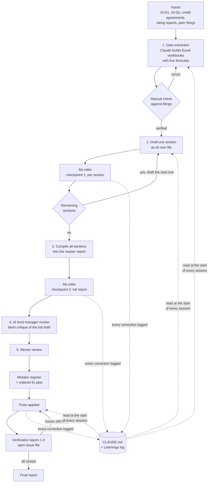

# Claude-Based Credit Research Pipeline

A system I built during my fixed income research internship to produce **Credit Initiation Reports** with Claude: from raw annual and quarterly filings to a finished, reviewed report.

**Result:** turnaround dropped from **6 days to 3.5 days per issuer**, with a human reviewing every step.

> The report itself, the firm's methodology and all client material are confidential and not included. This repo documents **how the system was built**: the instruction files, the workflow, the review loop and the mistakes it learned from. Examples come from one report on a large US-listed consumer issuer, referred to here as "the issuer."

---

## The idea

An LLM can draft a credit report in minutes. The hard part is making it **right**: every number traceable to a filing, every convention applied the same way everywhere, and no mistake made twice.

So the pipeline is less about prompting and more about **control**:

- **Closed loop.** Claude works only from filings and documents I verified and supplied. No web search.
- **One step at a time.** Claude finishes a section, shows it to me, and waits for approval before moving on.
- **Memory.** Every correction is written to a learnings log that Claude reads at the start of every session.
- **Layered review.** Mentor comments, a table-of-contents audit and an AI "fund manager" critique each find different kinds of errors.

---

## How it works

### 1. Data extraction
Claude reads the filings and builds the core Excel workbooks: annual and quarterly financials, a key financial snapshot, credit ratios, peer comparison, capital structure and covenants.

- **Every derived cell is a live formula**, never a pasted number, so any figure can be audited by clicking it.
- The extraction workbook is checked by a human (me) against the filings, line by line. It then becomes the **single source of truth** that every later section must match.

### 2. Section by section
Each section is built **as its own file**, in an order set by a workflow file and the firm's standard TOC (table of contents). The forward-looking parts (credit outlook, investment thesis and a weighted credit scorecard) come last, because they depend on everything else.

**Checkpoint 1:** after each section, Claude stops. I review it and edit it myself where needed, and my saved version becomes the source of truth before the next section starts.

### 3. Compile
Once every section is approved, they are assembled into one master report in TOC (table of contents) order.

**Checkpoint 2:** I review and edit the full compiled report. This catches what section-level review can't: contradictions between sections, repeated content, inconsistent numbers and formatting.

### 4. Review loop
See [Review and verification](#review-and-verification) below.

### The final report

The final document contained various sections looking at the company from different angles, including its financials, financial covenants and management.

---

## The control files

| File | What it does |
|---|---|
| [`CLAUDE.md`](system/CLAUDE.md) | Project brain: folder map, working rules, current conventions. Kept under 100 lines. |
| [`workflow.md`](system/workflow.md) | The step-by-step build order, from extraction to final check. |
| [`writing-rules.md`](system/writing-rules.md) | Standing rules from mentors and my own manual edits. |
| [`review-instructions.md`](system/review-instructions.md) | What Claude must do when mentor feedback arrives. |
| [`verification.md`](system/verification.md) | The three verification layers and the open-issue file protocol. |
| [`learnings-log.md`](examples/learnings-log.md) | Excerpt of the running log of mistakes and the corrected process. |

---

## Review and verification

Feedback arrives from three directions, and each catches different problems.

**1. AI fund manager.** A separate Claude session reads the full draft as a skeptical bond fund manager would. On one draft it raised **58 issues**: 9 critical, 21 material and 28 on presentation. See [`examples/ai-fund-manager-review.md`](examples/ai-fund-manager-review.md).

**2. Mentor review → mistake register → fix plan.** When mentor comments come back, Claude does not start fixing. It:
1. Logs every comment, word for word, in a numbered **mistake register**.
2. Writes a **fix plan** ordered from most invasive (re-extracting data, rewriting a section) to most cosmetic (font size, dates).
3. **Stops** and waits for my go-ahead.

If Claude spots a mistake the mentor missed, it tells me in chat. It never fixes it silently.

**3. Three verification layers**, each run only when I ask:

| Layer | Question it answers |
|---|---|
| 1. Mentor compliance | Did every flagged mistake actually get fixed, everywhere it appears? |
| 2. TOC (table of contents) audit | Does the report match the required table of contents section by section? |
| 3. Fund manager read | Would a professional reader trust this cover to cover? |

Findings go into one **open-issue file**. A line is deleted only after Claude opens the actual report and confirms the fix. A fix Claude only says it made doesn't count.

---

## Outputs

**Excel workbooks** (all live formulas, each cell traceable to a filing):
data extraction (5 years annual + 5 quarters) · key financial snapshot · financial and credit analysis · peer comparison · re-rating parameters · scorecard supporting data · capital structure and covenant analysis

**Report sections** (Word): each section built as its own file, then assembled into the final report.

---

## Mistakes it made, and how they were caught

The most useful part of the system is the record of what went wrong. Some representative cases:

| Mistake | How it was caught | Fix, and the rule added |
|---|---|---|
| Capex and FCF were wrong, giving three different FCF figures in one report | AI fund manager + mentor | Capex re-extracted from each cash flow statement; one FCF definition per document |
| FCF formula added capex instead of subtracting it (capex stored as a negative) | Claude's own QC | Sign conventions reconciled to the issuer's reported totals |
| Pasted Python-computed values into Excel instead of formulas | Me | **Every derived cell must be a live formula** |
| Said a metric was "not disclosed" when the filing did disclose it | Independent re-extraction by a separate subagent | Verify every "not disclosed" claim against the filing text |
| A convention change was fixed in the workbook but stale figures stayed in four Word sections | Downstream check | **Any project-wide change needs a full search across every draft** |
| A blanket find-and-replace for em dashes broke Excel formulas | Claude's own QC | Separate prose text from formula placeholders before bulk edits |
| Industry section had no market size, CAGR or chart, and read as "AI generated" | Mentor | Rebuilt from a named industry source with a chart |

Full excerpt: [`examples/learnings-log.md`](examples/learnings-log.md) · Mentor round example: [`examples/mentor-review-round.md`](examples/mentor-review-round.md)

---

## Design principles

1. **Closed loop.** Only verified inputs; no internet unless I explicitly allow it.
2. **Human in the loop at every step.** Claude proposes, I approve.
3. **Ask, don't guess.** When two readings of an instruction give different numbers, Claude stops and asks with a concrete example.
4. **Blocked ≠ stuck.** Missing inputs go into a pending-requirements file, and work moves to the next step.
5. **My edits win.** If I edit a delivered file by hand, that version becomes the new source of truth.
6. **Write it down.** Every correction becomes a dated one-line rule in the learnings log.

---

## Tools

Claude (Cowork, with folder access and subagents) · Python (openpyxl, pandas, pdftotext) · docx-js for Word output · Excel
